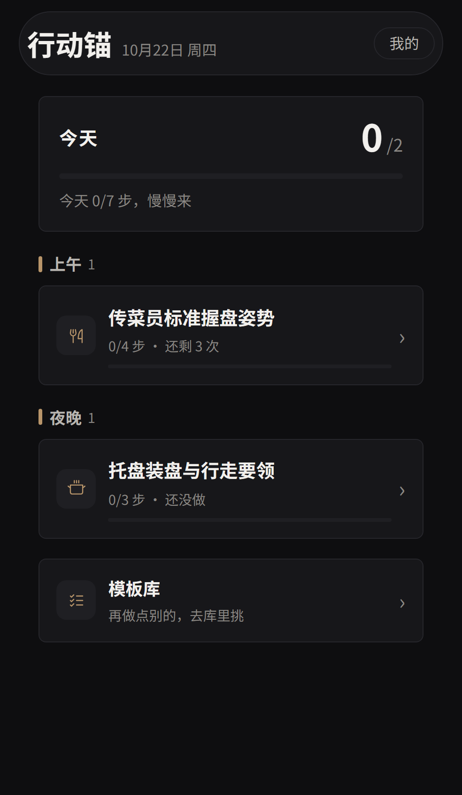
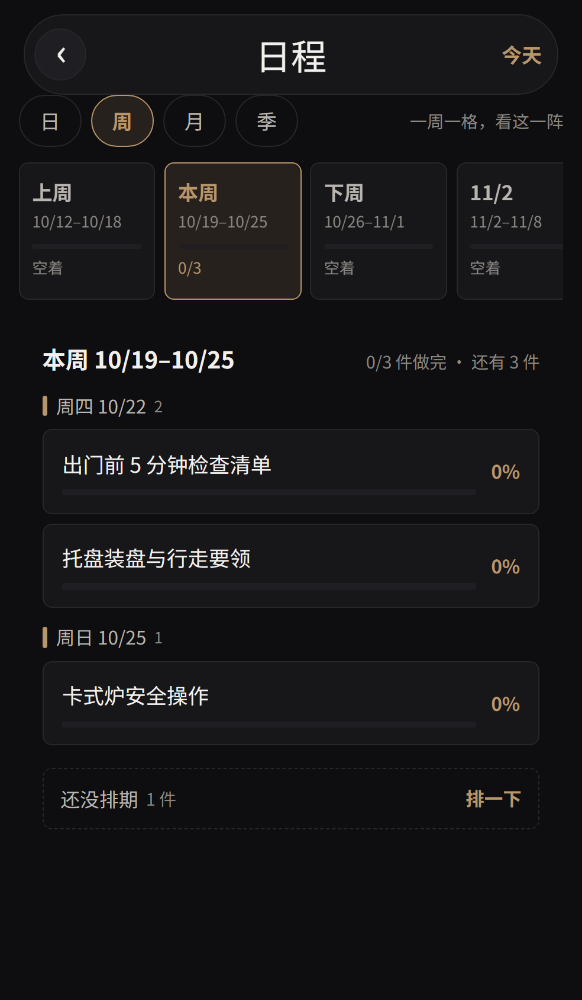
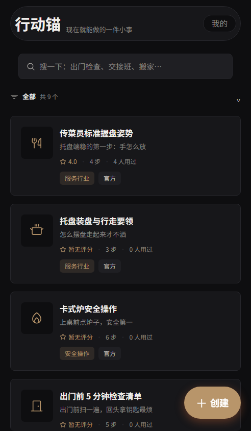
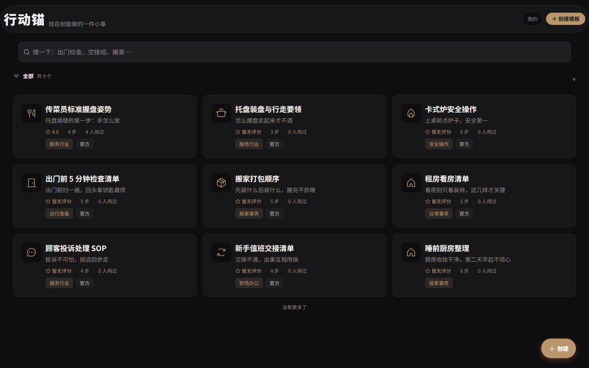

# 行动锚 · XingDongMao

> 一个把「想做」变成「在做」的每日计划工具。
> 模板不是货架，是弹药；主页不是目录，是今天。

在线站点：https://xingdongmao.com/app/ （H5，同时有一套微信小程序代码）

<p>
  
  
  
</p>



---

## 这是什么

大多数人不是不知道该做什么，而是「知道，但没做」。行动锚把注意力从「收藏了多少模板」挪到「今天做没做」，围绕这一件事设计：

- **今天主页**：打开就看到今天要做的事，按上午 / 下午 / 夜晚分组，一条进度条告诉你今天走到了哪，做完了替你收工。
- **模板库**：生活类与职业类 SOP 模板（传菜、托盘、开店、家务、健身……），点一下就能变成今天的任务。模板是弹药，不是收藏品。
- **任务系统**：一条任务可以是「一次」「配额」（例如一周两次）或「习惯」；带步骤、时段、排期。
- **时间轴日程**：日 / 周 / 月 / 季四档视图。手机上用手指滑、电脑上用鼠标拖、用滚轮滚，三种方式都行。
- **搜索**：模糊搜索模板，多选合并成一条任务后直接加入今天。
- **分享卡**：服务端 Pillow 渲染的模板分享图，中文字体随仓库附带，新克隆的环境也能直接出图。

> 版本说明：本仓库是 2026-10-22 的代码快照。

## 目录结构

```
backend/     Django 后端（REST API + 管理后台 + 分享图渲染）
  api/       序列化、视图聚合、分享图
  quick/     模板库（QuickPattern / QuickStep）
  tasks/     任务（UserTask / UserTaskStep / TaskDay）
  plans/     早期日程模型（网页版沿用）
  users/     账号（allauth + 微信登录占位）
  pattern/   Django 工程配置（settings / urls / wsgi）
  static/    图标与中文字体（分享图依赖，故意入库）

frontend/    uni-app 前端（一套代码，H5 + 微信小程序）
  pages/     index（今天）/ library（模板库）/ tasks / schedule / search
             / execute / create / detail / login / mine
  components/ task-sheet / step-sheet / share-sheet / app-icon / 引导
```

## 技术栈

| 层 | 选型 |
|---|---|
| 后端 | Django 6.0.6 + django-allauth + PostgreSQL（psycopg2），Pillow 渲染分享图 |
| 前端 | uni-app（Vue 3 语法），H5 与微信小程序共用一套页面 |
| 部署 | nginx + gunicorn，systemd 托管 |

## REST API 一览

前缀 `/api/v1/`。统一响应封装为 `{ok, data, error}`；除公开列表外均需 Token 认证（`Authorization: Token <key>`）；列表接口统一分页。

### 认证

| 方法 | 路径 | 说明 |
|---|---|---|
| POST | `/auth/register/` | 邮箱注册 |
| POST | `/auth/login/` | 邮箱登录，返回 Token |
| POST | `/auth/forgot/` | 发送重置密码邮件 |
| POST | `/auth/reset/` | 凭邮件 token 重置密码 |
| POST | `/auth/wx-login/` | 微信小程序登录（code 换 openid） |
| POST | `/auth/dev-login/` | 开发环境调试登录（仅 DEBUG） |

### 模板库

| 方法 | 路径 | 说明 |
|---|---|---|
| GET / POST | `/quick/` | 模板列表（分页 / 标签 / 搜索）/ 新建草稿 |
| GET | `/quick/<id>/` | 模板详情 |
| PUT | `/quick/<id>/edit/` | 编辑草稿 |
| DELETE | `/quick/<id>/delete/` | 删除 |
| GET | `/quick/me/` | 我创建的模板 |
| GET | `/quick/tags/` | 标签聚合 |
| GET | `/quick/suggest/` | 搜索联想 |
| GET | `/quick/history/` | 浏览记录 |
| GET | `/quick/my-favorites/` | 我的收藏 |
| GET | `/quick/my-notes/` | 我的笔记 |
| POST | `/quick/<id>/execute/` | 记录一次执行 |
| POST | `/quick/<id>/rate/` | 评分 |
| POST / GET | `/quick/<id>/note/` · `/notes/` | 写笔记 / 笔记列表 |
| POST | `/quick/<id>/fork/` | 复刻为自己的草稿 |
| POST | `/quick/<id>/favorite/` · `/unfavorite/` | 收藏 / 取消收藏 |
| POST | `/quick/<id>/publish/` | 发布上架 |
| GET | `/quick/<id>/share/` | 生成分享图（Pillow 渲染 PNG） |
| POST | `/quick/merge/` | 多选合并为新草稿 |
| POST | `/quick/import/` | 导入单个模板 |
| POST | `/quick/batch-import/` | 批量导入（仅 staff） |

### 任务

| 方法 | 路径 | 说明 |
|---|---|---|
| GET / POST | `/tasks/` | 今日任务 / 新建（once · quota · habit） |
| GET | `/tasks/calendar/?month=YYYY-MM` | 按月取日历 |
| POST | `/tasks/from-step/` | 由模板步骤生成任务 |
| GET / DELETE | `/tasks/<id>/` | 详情 / 删除（归档） |
| POST | `/tasks/<id>/steps/` | 新增步骤 |
| POST / DELETE | `/tasks/<id>/steps/<sid>/` | 勾选完成 / 删除步骤 |

### 用户

| 方法 | 路径 | 说明 |
|---|---|---|
| GET / PUT | `/me/profile/` | 个人资料 |
| POST | `/me/avatar/` | 上传头像 |

## 本地跑起来

### 后端

需要本机有 PostgreSQL。

```bash
cd backend
python -m venv .venv
```

激活虚拟环境（选你系统的）：

```bash
# Windows PowerShell
.venv\Scripts\Activate.ps1

# macOS / Linux
source .venv/bin/activate
```

安装依赖并初始化：

```bash
pip install -r requirements.txt

# 复制环境变量模板（Windows 用 copy）
cp .env.example .env

python manage.py migrate
python manage.py runserver
```

数据库连接、密钥、邮件配置全部通过 `.env` 注入，**仓库里不含任何密钥**。

### 前端

用 HBuilderX 打开 `frontend/`，可直接运行到浏览器（H5）或微信开发者工具（小程序）。

H5 的挂载前缀由 `frontend/manifest.json` 里的 `h5.router.base` 决定，部署时须与网关路径保持一致。

## 环境变量

见 `backend/.env.example`，全部由 `python-decouple` 读取。缺失关键项（`SECRET_KEY`、数据库）会导致启动失败，这是有意为之。

## 说明

- **开发方式**：Spec 驱动 + AI 协作。接口契约、数据模型与部署方案由我设计，编码环节借助 AI 提效。
- 这是一个个人项目，仍在持续迭代。
- 仓库为 2026-10-22 的快照，功能以该时点为准。
- 未附带开源许可证：代码公开用于阅读与学习，保留所有权利。
